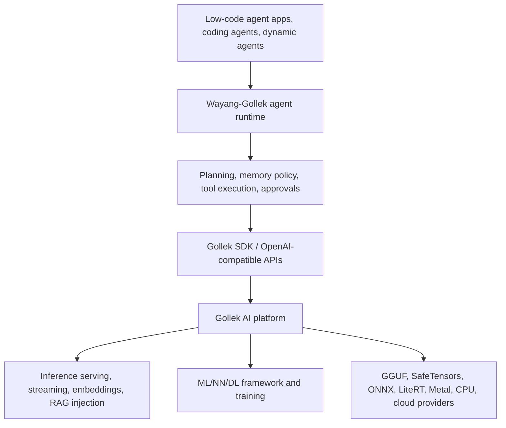

# Wayang-Gollek Agent System

Wayang-Gollek is the agentic system engine that runs on top of Gollek. It is the right home for coding agents, dynamic agents, multi-agent orchestration, low-code agent builders, memory policy, tool execution, approval gates, and workflow state.

Gollek remains the AI platform underneath it: inference and serving, embeddings, RAG context injection, model runtimes, ML/NN/DL APIs, training, plugins, and SDK compatibility.

## Why This Split Matters

Keeping the split explicit prevents overlap:

- Gollek stays modular and useful as a general AI platform.
- Wayang-Gollek can move fast on agent UX, orchestration, and product workflows.
- Other agent frameworks can still use Gollek through OpenAI-compatible APIs, MCP discovery, embeddings, and the Java SDK.
- Runtime, training, and backend work does not get tangled with planning, memory, and tool execution policy.

## Layered Architecture



## Responsibility Matrix

| Capability | Gollek | Wayang-Gollek |
|---|---|---|
| Inference serving | Owns | Consumes |
| OpenAI-compatible Chat/Responses APIs | Owns | Consumes |
| Embedding generation | Owns | Uses for retrieval workflows |
| RAG context injection | Owns request injection | Owns retrieval and ranking |
| MCP discovery and tool schema exposure | Owns contract exposure | Owns client execution loop |
| Tool-call output formatting | Owns model/API shape | Owns execution and authorization |
| System prompt transport | Owns request support | Owns prompt strategy |
| Model runtimes and provider routing | Owns | Selects by policy |
| Training, ML, NN, DL | Owns | Uses outputs and models |
| Agent planning and orchestration | Does not own | Owns |
| Memory lifecycle and summarization | Does not own | Owns |
| Low-code agent platform | Does not own | Owns |
| Human approval and workflow state | Does not own | Owns |

## How Wayang-Gollek Should Use Gollek

Wayang-Gollek should integrate with Gollek through stable serving and SDK surfaces:

1. Discover model and serving capabilities from Gollek.
2. Validate chat, Responses, tool, embedding, and RAG payloads before execution.
3. Generate embeddings with Gollek, then run retrieval in a caller-owned vector store.
4. Pass selected retrieval chunks back to Gollek as `rag_context`.
5. Send system prompts, user messages, tools, and MCP-derived tool schemas through Gollek's OpenAI-compatible endpoints.
6. Stream responses and tool-call declarations back into the Wayang-Gollek execution loop.
7. Execute tools, update memory, request approvals, and choose the next action in Wayang-Gollek.

## Gollek Agent-Facing Surfaces

These Gollek surfaces exist to support external agent systems without becoming one:

- Agent capabilities and contract discovery.
- Per-model route capability discovery.
- Request and tool schema validation.
- MCP server and tool discovery.
- OpenAI-compatible Chat Completions and Responses.
- OpenAI-compatible Embeddings.
- Typed SDK views for serving readiness, streaming, response parsing, tool calls, embeddings, trace headers, and usage metadata.

The naming in Gollek docs should describe these as agent integration or agent compatibility surfaces. The runtime that makes decisions remains Wayang-Gollek.

## Good Integration Shape

```java
AgentModelCapabilitiesView model = gollek.agent().modelCapabilitiesView("demo-model", trace);
if (!model.hasRequiredAgentServingRoute()) {
    throw new IllegalStateException("Model cannot serve this agent route: "
        + model.agentServingRouteIssues());
}

AgentMcpDiscoveryView tools = gollek.agent().mcpToolsView(true, true);
if (!tools.discoveryOnly()) {
    throw new IllegalStateException("MCP discovery endpoint crossed the serving boundary");
}

AgentEmbeddingView embedding = gollek.agent().createEmbeddingView(Map.of(
    "model", "demo-embed",
    "input", List.of("Find context for this task")
), trace);

List<Map<String, Object>> retrievedChunks = wayangRetrieval.search(embedding.firstVector());

AgentResponseView response = gollek.agent().createChatCompletionView(Map.of(
    "model", "demo-model",
    "messages", messages,
    "tools", tools.openAiToolDefinitions(),
    "rag_context", retrievedChunks
), trace);

wayangAgentLoop.handle(response.toolCalls(), response.outputText());
```

In this shape, Gollek serves model capabilities. Wayang-Gollek decides the workflow.

## Related Docs

- [Agent Integration Boundary](/docs/agent-integration-boundary)
- [Agent Integration API](/docs/agent-integration-api)
- [Inference Serving](/docs/runtime/inference-serving)
- [Runtime Architecture](/docs/runtime/architecture)
- [SDK Modules](/docs/sdk-modules)
- [Production Hardening](/docs/production-hardening/)
