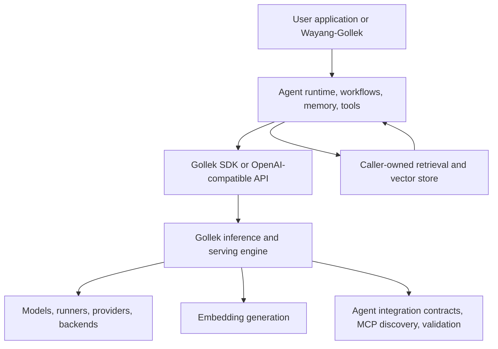

# Agent Integration Boundary

Gollek is the AI platform layer: inference, serving, embeddings, model runtimes, ML/NN/DL APIs, training, plugins, and deployment surfaces. Wayang-Gollek is the agentic system engine that runs on top of Gollek through the SDK, OpenAI-compatible APIs, and integration contracts.

This boundary keeps Gollek useful as a one-stop AI platform without turning it into a monolithic agent framework.

## Product Split

| Layer | Product | Primary Responsibility |
|---|---|---|
| Agent system | Wayang-Gollek | Coding agents, dynamic agents, low-code workflows, orchestration, memory policy, tool execution, approval flows |
| AI platform | Gollek | Inference serving, embeddings, RAG context injection, model/runtime management, training, ML/NN/DL APIs, SDKs |
| Runtime backends | Gollek runners/providers | GGUF, SafeTensors, ONNX, LiteRT, Metal, CPU, cloud providers, plugin backends |

## What Gollek Owns

Gollek should provide stable substrate capabilities that any agent system can consume:

- OpenAI-compatible Chat Completions, Responses, and Embeddings endpoints.
- Streaming events, usage reporting, trace metadata, and structured errors.
- System prompt and developer message transport into model requests.
- Tool schema validation and tool-call output formatting.
- MCP discovery and contract exposure.
- Embedding generation for caller-owned retrieval pipelines.
- RAG context injection into inference requests when callers provide selected context.
- Model capability discovery, provider routing, runtime configuration, and health checks.
- ML/NN/DL framework APIs, training workflows, quantization, and export paths.

Gollek can expose `client.agent()` helpers in the SDK, but those helpers are integration adapters. They should not become planners, memory systems, or workflow engines.

## What Wayang-Gollek Owns

Wayang-Gollek should own the higher-level agentic behavior:

- Agent planning, reflection, retry policy, and task decomposition.
- Coding agents, dynamic agents, and low-code agent builders.
- Tool execution, tool authorization, sandbox policy, and human approval.
- Memory storage, memory selection, summarization policy, and lifecycle.
- RAG retrieval strategy, vector-store selection, ranking, and source policy.
- MCP client execution loops and external server lifecycle.
- Multi-agent orchestration, queues, workflow state, and handoff protocols.
- UI, workspace experiences, templates, and operator controls.

Wayang-Gollek calls Gollek for model work. It should not need to fork or duplicate Gollek runtime behavior.

## Runtime Flow

The important rule is directional: Wayang-Gollek orchestrates decisions and calls Gollek. Gollek serves model capabilities and returns structured outputs.

## Boundary Rules

When adding a feature, place it in Gollek if it is about model execution, request compatibility, runtime capability discovery, SDK transport, training, or backend performance.

Place it in Wayang-Gollek if it decides what an agent should do next, stores or chooses memory, executes tools, manages approvals, coordinates multiple agents, or renders low-code workflows.

| Feature Question | Belongs In |
|---|---|
| Does this expose or run a model capability? | Gollek |
| Does this normalize an inference, embedding, tool schema, or stream response? | Gollek |
| Does this validate a request without executing external side effects? | Gollek |
| Does this decide which tool to call and then execute it? | Wayang-Gollek |
| Does this select documents from a vector store? | Wayang-Gollek |
| Does this manage memory, workflow state, approval, or retry policy? | Wayang-Gollek |
| Does this provide a low-code agent builder or UI? | Wayang-Gollek |

## Current Gollek Agent-Facing Surfaces

Gollek's agent-facing features should be documented as integration surfaces:

- `GET /v1/agent/capabilities`
- `GET /v1/agent/contract`
- `GET /v1/models/{id}/capabilities`
- `POST /v1/agent/preflight`
- `POST /v1/agent/validate`
- `POST /v1/agent/tools/validate`
- `GET /v1/mcp/servers`
- `GET /v1/mcp/tools`
- `POST /v1/chat/completions`
- `POST /v1/responses`
- `POST /v1/embeddings`

The remote SDK mirrors those surfaces with typed helpers for request options, streaming events, non-streaming response views, and embedding views. These helpers reduce glue code for external agent systems while preserving separation of concern.

Serving feature profiles such as `agent_serving`, `chat_agent`,
`responses_agent`, `embedding_rag`, and `mcp_tools` are Gollek-side shortcuts
for required API capabilities. They are not Wayang agent templates. Wayang can
use them to choose the right preflight gate, then still own planning, retrieval,
memory, tool execution, and workflow state.

Preflight policy profiles are also Gollek-side integration gates, not agent
behavior. `readiness_only` checks whether the serving route is usable,
`requested_route` also requires the selected model/surface/profile to match the
request, and `clean` also blocks on warnings. These policies help CI,
production startup checks, and low-code publishing flows decide whether a
Gollek serving route is acceptable before Wayang-Gollek starts an agent loop.
They do not select plans, run retrieval, execute tools, store memory, or retry
tasks.

## Documentation Names

Prefer these names in Gollek documentation:

- Agent Integration API
- Agent Serving Contract
- Agentic Compatibility Layer
- Agent SDK Helpers

Avoid naming Gollek features as if Gollek itself is the agent runtime. The agent runtime is Wayang-Gollek.

## Related Docs

- [Agent Serving Quick Start](/docs/tutorials/integrations/agent-serving)
- [Agent Integration API](/docs/agent-integration-api)
- [Wayang-Gollek Agent System](/docs/agent-framework/)
- [Inference Serving](/docs/runtime/inference-serving)
- [Runtime Architecture](/docs/runtime/architecture)
- [SDK Modules](/docs/sdk-modules)
- [CLI Installation](/docs/setup/cli-installation)
