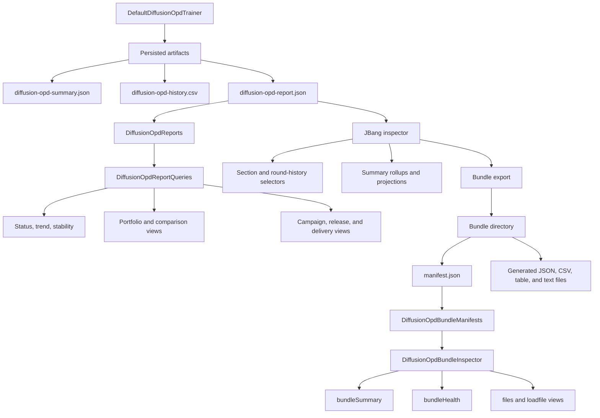

# DiffusionOPD Docs

This is the landing page for Gollek’s DiffusionOPD documentation set.

The DiffusionOPD lane now spans more than just trainer setup. It includes:

- the Java-first training scaffold
- normalized report artifacts
- typed Java report-query APIs
- campaign, release, and delivery report views
- JBang-based terminal inspection
- bundle export, manifest inspection, and bundle health validation

Use this page as the quickest way to choose the right document for the task in
front of you.

---

## Which page should I read?

- If you want the architecture and module story, start with [DiffusionOPD in Gollek](/docs/framework/diffusion-opd).
- If you want the typed report, query, campaign, and delivery API surface, go to [DiffusionOPD Reporting and Inspection](/docs/framework/diffusion-opd-reporting).
- If you want the Java application workflow from trainer artifacts into typed query usage, use [DiffusionOPD Reporting Workflow](/docs/tutorials/advanced/diffusion-opd-report-workflow).
- If you want the terminal-first workflow for selectors, exports, and bundle checks, use [DiffusionOPD JBang Inspector Workflow](/docs/tutorials/advanced/diffusion-opd-jbang-inspector).
- If you only need selector syntax, bundle grammar, or projection names, jump straight to [DiffusionOPD Selector Reference](/docs/framework/diffusion-opd-selector-reference).

---

## Do you have one report or two?

- If you only have one `diffusion-opd-report.json`, start with:
  - [DiffusionOPD Reporting and Inspection](/docs/framework/diffusion-opd-reporting)
  - [DiffusionOPD JBang Inspector Workflow](/docs/tutorials/advanced/diffusion-opd-jbang-inspector)
- If you have a stable baseline plus a new run, start with:
  - [DiffusionOPD Baseline Strategy](/docs/framework/diffusion-opd-baseline-strategy)
  - [DiffusionOPD Reporting Workflow](/docs/tutorials/advanced/diffusion-opd-report-workflow)

Rule of thumb:

- one report leads to status, trend, summary, selector, and bundle-export work
- two reports lead to campaign, release, and delivery comparison work

---

## Architecture map



In practice, the flow is:

- the trainer writes normalized artifacts
- `DiffusionOpdReports` loads the typed report boundary
- `DiffusionOpdReportQueries` builds application-facing analysis and orchestration views
- the JBang inspector gives a terminal-first path over the same report
- bundle export creates a manifest-backed output directory
- bundle manifest and health APIs validate and reopen that exported pack

---

## Where does this live in the repo?

The main implementation and example entrypoints live here:

| Area | Path | What you find there |
|------|------|---------------------|
| DiffusionOPD API contracts | `gollek/training/gollek-train-diffusion-api/` | Typed public records and interfaces for reports, campaigns, releases, and delivery/export views |
| DiffusionOPD implementation | `gollek/training/gollek-train-diffusion-opd/` | Trainer, report loaders, query helpers, bundle inspection APIs, and JBang-facing support surfaces |
| Java training examples | `gollek/training/gollek-train-examples/` | Gradle examples for OPD trainer and stable-diffusion bridge workflows |
| JBang entrypoints | `gollek/examples/jbang/trainer/` | `trainer_diffusion_opd_ddim.java`, `trainer_diffusion_opd_report_inspector.java`, and related terminal wrappers |

If you are looking for the fastest practical starting points in the repo, use:

- `gollek/training/gollek-train-diffusion-opd/src/main/java/tech/kayys/gollek/train/diffusion/opd/`
- `gollek/examples/jbang/trainer/trainer_diffusion_opd_report_inspector.java`
- `gollek/examples/jbang/trainer/README.md`

---

## What's stable vs evolving?

### Stable enough to build against now

- persisted artifact names such as `diffusion-opd-summary.json`,
  `diffusion-opd-history.csv`, and `diffusion-opd-report.json`
- typed report loading through `DiffusionOpdReports`
- typed analysis and orchestration entrypoints in `DiffusionOpdReportQueries`
- bundle manifest loading and bundle inspection through
  `DiffusionOpdBundleManifests` and `DiffusionOpdBundleInspector`
- the JBang report-inspector workflow and its selector/bundle vocabulary as
  documented in the current reference pages

These are the surfaces to prefer for downstream tools, dashboards, review
workflows, and CI-style bundle validation.

### Still likely to evolve

- the exact trainer feature set around newer OPD runtime strategies
- example-lane fixture conventions and local repo wiring for native
  stable-diffusion experiments
- the depth and shape of higher-level campaign, release, and delivery record
  families as the orchestration lane continues to mature
- secondary docs and examples that explain operational patterns around the main
  APIs

Rule of thumb:

- build integrations against the typed artifact, query, and bundle boundaries
- treat examples, experimental fixture paths, and some higher-order workflow
  polish as the parts most likely to keep moving

---

## Docs status

Current OPD docs coverage now includes:

- architecture and module overview
- persisted artifact and typed report boundary
- Java application workflow
- terminal-first JBang inspection workflow
- selector and bundle grammar reference
- reporting vocabulary glossary
- baseline/current comparison strategy

Recent additions in this docs cluster:

- landing page and architecture map
- starter command block
- selector quick cheat sheet
- JBang troubleshooting notes
- artifact-shape examples
- baseline strategy guide
- one-report vs two-report chooser
- repo-location guide
- stable-vs-evolving guidance

If you still cannot find an answer from this cluster, the next best places to
look are:

- `gollek/training/gollek-train-diffusion-opd/` in the repo
- `gollek/examples/jbang/trainer/README.md`
- the JBang inspector wrapper and examples under
  `gollek/examples/jbang/trainer/`

---

## Starter commands

If you want one minimal end-to-end terminal flow, start with:

```bash
# inspect the report overview
jbang trainer/trainer_diffusion_opd_report_inspector.java report.json overview

# rank the worst task summaries
jbang trainer/trainer_diffusion_opd_report_inspector.java report.json taskSummaries:sort=-meanLoss:top=5 table

# export a standard bundle
jbang trainer/trainer_diffusion_opd_report_inspector.java report.json bundle=standard json /tmp/opd-standard-bundle

# validate that bundle in one compact check
jbang trainer/trainer_diffusion_opd_report_inspector.java /tmp/opd-standard-bundle bundleHealth:ci
```

That is the shortest practical path from one persisted report to:

- one quick sanity check
- one ranked review view
- one reusable export pack
- one CI-style integrity signal

For the full terminal workflow, continue with
[DiffusionOPD JBang Inspector Workflow](/docs/tutorials/advanced/diffusion-opd-jbang-inspector).

---

## Start here

| Page | Best for |
|------|----------|
| [DiffusionOPD in Gollek](/docs/framework/diffusion-opd) | Understand the trainer, module boundaries, adapters, and artifact-emission story |
| [DiffusionOPD Reporting and Inspection](/docs/framework/diffusion-opd-reporting) | Understand the typed report, query, campaign, release, and bundle-inspection APIs |
| [DiffusionOPD Reporting Workflow](/docs/tutorials/advanced/diffusion-opd-report-workflow) | Follow the Java application path from training artifacts into typed query usage |
| [DiffusionOPD JBang Inspector Workflow](/docs/tutorials/advanced/diffusion-opd-jbang-inspector) | Follow the terminal-first path for selectors, exports, and bundle validation |
| [DiffusionOPD Selector Reference](/docs/framework/diffusion-opd-selector-reference) | Look up selector syntax, bundle grammar, projections, and bundle health filters quickly |
| [DiffusionOPD Reporting Glossary](/docs/framework/diffusion-opd-glossary) | Decode the core reporting and inspection vocabulary quickly |
| [DiffusionOPD Baseline Strategy](/docs/framework/diffusion-opd-baseline-strategy) | Learn how to create, store, refresh, and compare stable baseline reports |

---

## Recommended paths by goal

### I want to add DiffusionOPD to an application

Read in this order:

1. [DiffusionOPD in Gollek](/docs/framework/diffusion-opd)
2. [DiffusionOPD Reporting and Inspection](/docs/framework/diffusion-opd-reporting)
3. [DiffusionOPD Reporting Workflow](/docs/tutorials/advanced/diffusion-opd-report-workflow)

This path is best when you need:

- trainer integration
- persisted report loading
- typed Java query usage
- campaign/release/delivery views in application code

### I want to inspect one run quickly from the terminal

Read in this order:

1. [DiffusionOPD JBang Inspector Workflow](/docs/tutorials/advanced/diffusion-opd-jbang-inspector)
2. [DiffusionOPD Selector Reference](/docs/framework/diffusion-opd-selector-reference)

This path is best when you need:

- one-off diagnostics
- ranked summary tables
- export bundles
- CI-style bundle health checks

### I want a quick grammar lookup

Go straight to:

- [DiffusionOPD Selector Reference](/docs/framework/diffusion-opd-selector-reference)

This is the right page when you already know the workflow and only need the
exact selector, bundle form, or projection name.

---

## What the docs cover

### Trainer and runtime boundary

Covered primarily in:

- [DiffusionOPD in Gollek](/docs/framework/diffusion-opd)

Topics:

- `gollek-ml-diffusion-api`
- `gollek-ml-diffusion-opd`
- `DefaultDiffusionOpdTrainer`
- runner adapters
- scheduler bridges
- stage-aware teacher bindings
- adaptive stage weighting
- diagnostics observers

### Report and query boundary

Covered primarily in:

- [DiffusionOPD Reporting and Inspection](/docs/framework/diffusion-opd-reporting)

Topics:

- `diffusion-opd-summary.json`
- `diffusion-opd-history.csv`
- `diffusion-opd-report.json`
- `DiffusionOpdReports`
- `DiffusionOpdReportQueries`
- compatibility vs canonical release-delivery export lanes

### Terminal inspection boundary

Covered primarily in:

- [DiffusionOPD JBang Inspector Workflow](/docs/tutorials/advanced/diffusion-opd-jbang-inspector)
- [DiffusionOPD Selector Reference](/docs/framework/diffusion-opd-selector-reference)

Topics:

- grouped and paired summary selectors
- projection presets like `compact`, `details`, and `compare`
- bundle export selectors
- bundle summary and health selectors
- `loadfile:` and `filesSummary:` views

---

## Suggested reading order for new contributors

If you are onboarding to this area of the codebase, the most effective order
is:

1. [DiffusionOPD in Gollek](/docs/framework/diffusion-opd)
2. [DiffusionOPD Reporting and Inspection](/docs/framework/diffusion-opd-reporting)
3. [DiffusionOPD Reporting Workflow](/docs/tutorials/advanced/diffusion-opd-report-workflow)
4. [DiffusionOPD JBang Inspector Workflow](/docs/tutorials/advanced/diffusion-opd-jbang-inspector)
5. [DiffusionOPD Selector Reference](/docs/framework/diffusion-opd-selector-reference)
6. [DiffusionOPD Reporting Glossary](/docs/framework/diffusion-opd-glossary)
7. [DiffusionOPD Baseline Strategy](/docs/framework/diffusion-opd-baseline-strategy)

That sequence moves from architecture, to artifacts, to Java usage, to
terminal usage, and finally to syntax lookup.

---

## Related docs

- [Gollek Framework](/docs/framework/)
- [DiffusionOPD Reporting Glossary](/docs/framework/diffusion-opd-glossary)
- [DiffusionOPD Baseline Strategy](/docs/framework/diffusion-opd-baseline-strategy)
- [SDK Modules](/docs/sdk-modules)
- [Runtime Architecture](/docs/runtime/architecture)
