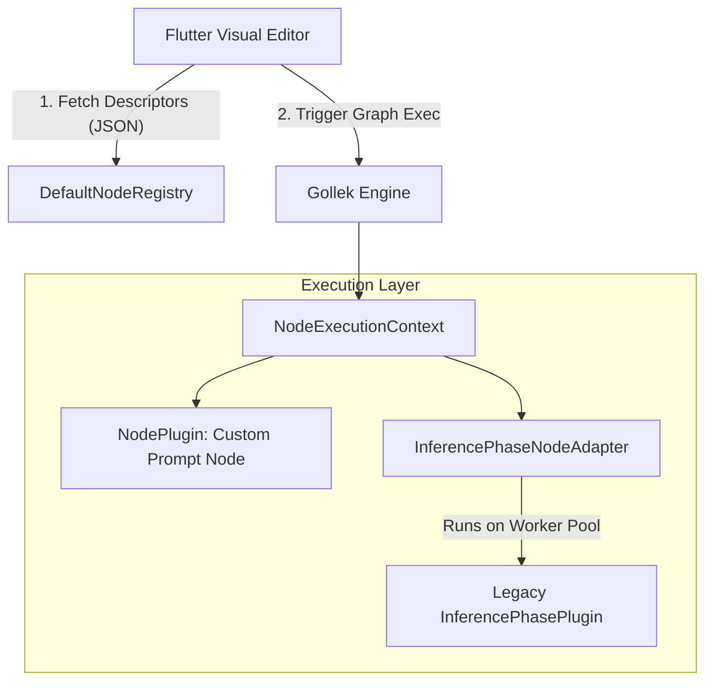

# Visual Node Workflows & NodePlugin SPI

To support dynamic AI orchestrations and visual node editors (such as a Flutter-based drag-and-drop node graph builder), Gollek features a strongly-typed, reactive, visual **Node Workflows** abstraction.

The architecture decouples the execution logic from the visual editor representation, exposing descriptors that can be serialized over JSON while running execution tasks asynchronously without blocking the reactive Vert.x event loop.

---

## Architectural Overview

The visual workflow layer sits on top of Gollek's core reactive SPI, exposing execution blocks as graph nodes connected via input/output ports.



### Key Core Constraints
* **Non-Blocking Vert.x Event Loop**: Node plugins must never block the event loop thread. Long-running CPU/IO operations are automatically scheduled on the worker pool.
* **Reflective AOT Compilation**: All visual descriptors, categories, and ports are mapped to immutable records registered for GraalVM reflection.

---

## Core SPI Components

The workflow API is located in the `:spi:gollek-spi` module under `tech.kayys.gollek.spi.node`.

### 1. The `NodePlugin` Interface
Every visual node extends `GollekPlugin` and must implement the `NodePlugin` contract, exposing its visual descriptor and its reactive execution method.

```java
package tech.kayys.gollek.spi.node;

import io.smallrye.mutiny.Uni;
import tech.kayys.gollek.spi.plugin.GollekPlugin;

public interface NodePlugin extends GollekPlugin {

    /**
     * Get the visual representation metadata for this node.
     */
    NodeDescriptor descriptor();

    /**
     * Reactively execute the node logic.
     * Uses NodeExecutionContext to read inputs and write outputs.
     */
    Uni<Void> execute(NodeExecutionContext context);
}
```

### 2. Sockets and Typed Sockets (`NodePort`)
Nodes declare their interface through input and output `NodePort` definitions. This allows visual editors to validate connection types.

* **Direction**: `INPUT` or `OUTPUT`
* **Data Types**:
  * `STRING`: Text streams/prompts
  * `NUMBER`: Temperatures, token limits, count parameters
  * `BOOLEAN`: Flag controls
  * `JSON`: Structured objects, schemas, tool definitions
  * `TENSOR`: Multi-dimensional output matrices
  * `CONTEXT`: Engine/graph state propagation

```java
NodePort inputPort = NodePort.builder()
    .name("prompt")
    .displayName("Prompt Text")
    .direction(NodePort.Direction.INPUT)
    .dataType(NodePort.DataType.STRING)
    .required(true)
    .defaultValue("")
    .build();
```

### 3. Visual Styling hints (`NodeCategory`)
An enum mapping nodes to semantic roles with associated icon and color guides for the Flutter frontend palette:

| Category | Typical Use | Flutter Visual Theme Hint |
|:---|:---|:---|
| `LLM` | Language model generators, routers | Deep Purple / `Icons.psychology` |
| `PROMPT` | String templates, prompt formatting | Amber / `Icons.edit_note` |
| `ROUTER` | Conditional routing, model selectors | Blue / `Icons.fork_right` |
| `MEMORY` | KV cache states, conversation histories | Emerald / `Icons.storage` |
| `TOOL` | Web search, calculators, database lookups | Red / `Icons.build` |
| `TRANSFORM`| Output normalization, JSON parsers | Orange / `Icons.transform` |
| `OUTPUT` | Final REST stream hooks | Cyan / `Icons.input` |

---

## Backward Compatibility: Inference Phase Adapter

Existing phase-based plugins (implementing `InferencePhasePlugin`) do not need to be rewritten to support the visual graph editor. Gollek features a built-in adapter:

### `InferencePhaseNodeAdapter`
This adapter automatically wraps a legacy phase plugin, extracts its metadata, formats its visual descriptor, and executes it.

```java
// Dynamically adapting a phase plugin
InferencePhasePlugin legacyPlugin = ...;
NodePlugin adaptedNode = new InferencePhaseNodeAdapter(legacyPlugin);
```

#### Off-Loop Thread Safety
To prevent a slow phase plugin (like a semantic caching lookup doing database lookups) from blocking the Vert.x event loop, the adapter runs the execution on the default worker pool:

```java
@Override
public Uni<Void> execute(NodeExecutionContext context) {
    return Uni.createFrom().item(context)
        .emitOn(Infrastructure.getDefaultWorkerPool())
        .map(ctx -> {
            // Adapted execution running on background thread pool
            legacyPlugin.execute(ctx.getEngineExecutionContext(), ctx.getEngineContext());
            return null;
        });
}
```

---

## Dynamic Discovery (`NodeRegistry`)

All node plugins and adapted phase plugins are registered dynamically in the CDI-managed `NodeRegistry` at boot.

```java
@ApplicationScoped
public class DefaultNodeRegistry implements NodeRegistry {
    private final Map<String, NodePlugin> registry = new ConcurrentHashMap<>();

    @Inject
    public void init(Instance<NodePlugin> customNodes, Instance<InferencePhasePlugin> phasePlugins) {
        // 1. Register custom NodePlugins
        customNodes.forEach(this::register);
        
        // 2. Wrap and register legacy phase plugins automatically
        phasePlugins.forEach(plugin -> register(new InferencePhaseNodeAdapter(plugin)));
    }
    
    // ...
}
```

---

## Frontend Serialization Example

When the Flutter UI queries the serving engine for available nodes, the `NodeDescriptor` is serialized to JSON. Here is an example payload representing a custom Prompt Template visual node:

```json
{
  "id": "tech.kayys.gollek.prompt.template",
  "name": "Prompt Template Node",
  "description": "Interpolates variable parameters into structured prompt templates.",
  "category": "PROMPT",
  "version": "1.0.0",
  "icon": "edit_note",
  "color": "#FFBF00",
  "inputs": [
    {
      "name": "template",
      "displayName": "Template String",
      "dataType": "STRING",
      "required": true,
      "defaultValue": "Translate to {language}: {text}"
    },
    {
      "name": "variables",
      "displayName": "Variable Arguments",
      "dataType": "JSON",
      "required": false
    }
  ],
  "outputs": [
    {
      "name": "formattedPrompt",
      "displayName": "Formatted Prompt",
      "dataType": "STRING"
    }
  ],
  "configProperties": {
    "stripWhitespace": "true",
    "failOnMissingVariable": "false"
  }
}
```

---

## Writing a Custom Visual Node Plugin

Creating a visual node workflow block is simple. Below is an example implementation of a prompt variables injector node:

```java
package tech.kayys.gollek.plugin.custom;

import io.smallrye.mutiny.Uni;
import jakarta.enterprise.context.ApplicationScoped;
import tech.kayys.gollek.spi.node.*;
import java.util.List;

@ApplicationScoped
public class PromptBuilderNodePlugin implements NodePlugin {

    private static final String ID = "tech.kayys.gollek.prompt.builder";

    @Override
    public String id() {
        return ID;
    }

    @Override
    public NodeDescriptor descriptor() {
        return NodeDescriptor.builder()
            .id(ID)
            .name("Prompt Builder")
            .description("Assembles structured user prompts with context injection")
            .category(NodeCategory.PROMPT)
            .version(version())
            .inputs(List.of(
                NodePort.input("template", NodePort.DataType.STRING, ""),
                NodePort.input("context", NodePort.DataType.STRING, "")
            ))
            .outputs(List.of(
                NodePort.output("prompt", NodePort.DataType.STRING)
            ))
            .build();
    }

    @Override
    public Uni<Void> execute(NodeExecutionContext context) {
        return Uni.createFrom().item(context)
            .map(ctx -> {
                String template = ctx.getInput("template", String.class).orElse("");
                String contextData = ctx.getInput("context", String.class).orElse("");
                
                // Perform prompt interpolation
                String assembledPrompt = template.replace("{context}", contextData);
                
                ctx.setOutput("prompt", assembledPrompt);
                return null;
            });
    }
}
```
