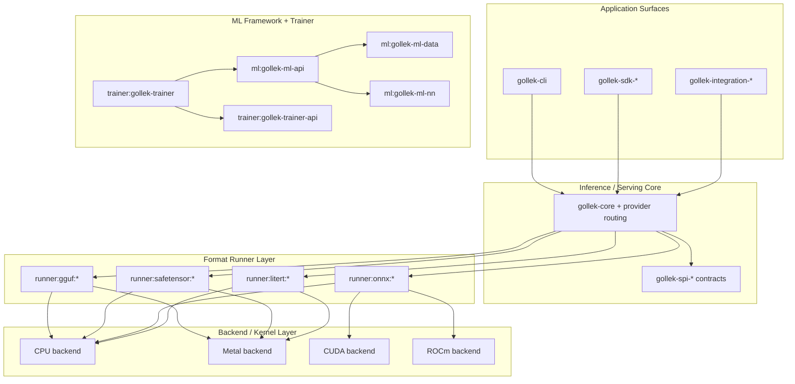
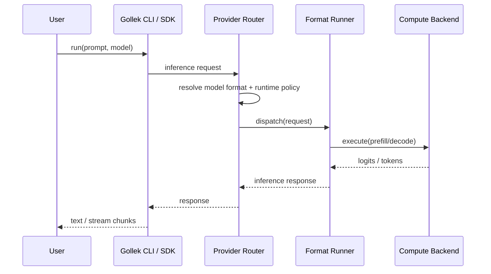
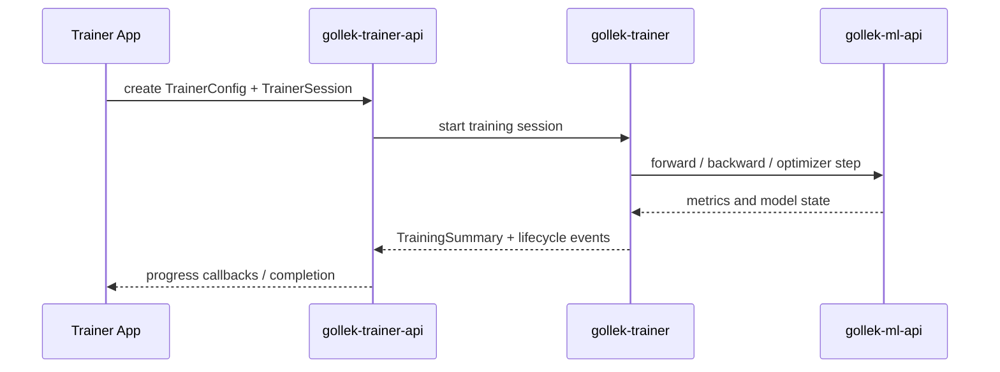

# Gollek Architecture Diagrams

This document outlines the high-level architecture, module boundaries, and dispatch sequences of the Gollek platform.

Gollek uses five major module families:

- inference/serving core: `gollek-core`, `gollek-spi-*`, provider routing
- format runners: `runner/*` (GGUF, Safetensor, ONNX, LiteRT, and others)
- ML framework: `gollek-ml-*`
- trainer: `gollek-trainer-*`
- integrations: `gollek-integration-*`

Some legacy pages still mention older `gollek-sdk-*` training-era names. Those should be read as compatibility terminology during migration.

## 1. High-Level Modular Architecture

The Gollek platform uses a layered architecture that keeps inference/serving concerns separate from framework/trainer concerns.

## 2. Inference Dispatch Sequence

When a request is served, Gollek resolves the model format and dispatches to the selected runner/backend path.

## 3. Trainer Execution Sequence

Trainer-facing APIs are split from the broader ML facade so orchestration can evolve independently.

